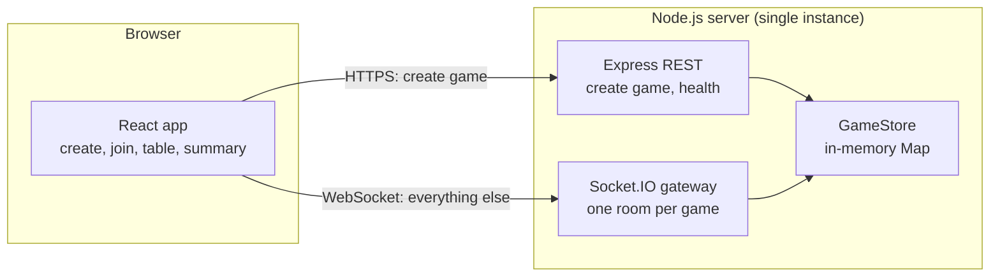
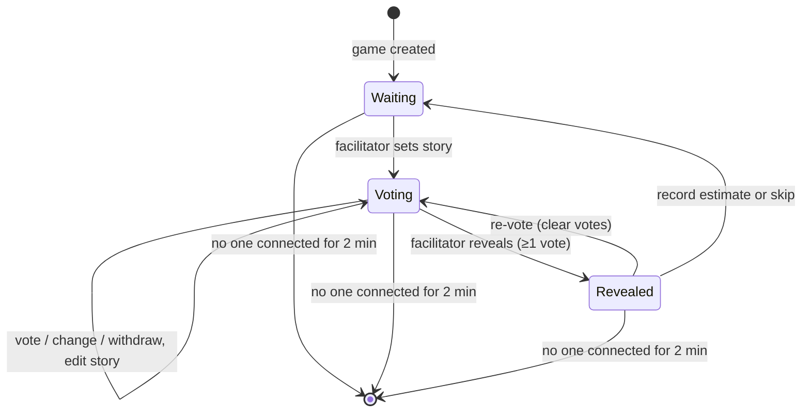
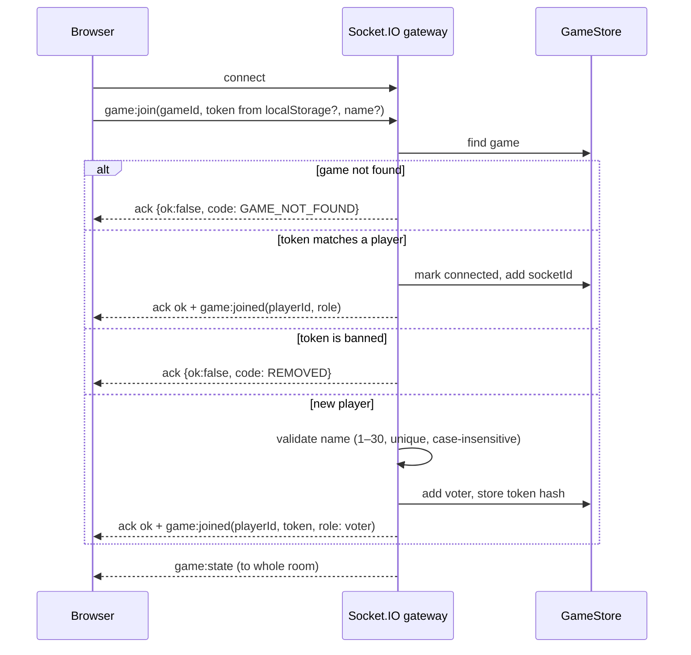
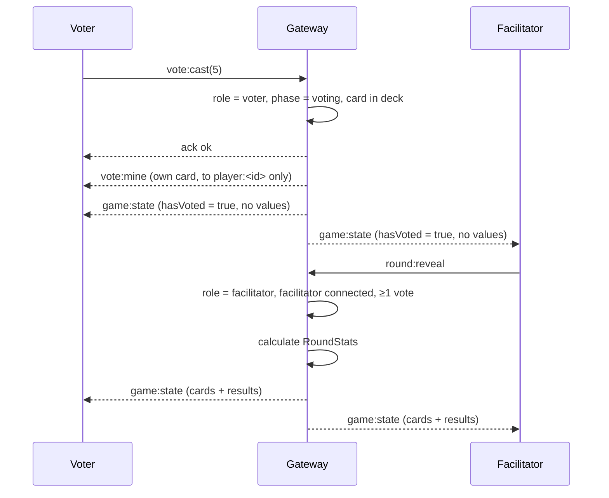

# Design: Planning Poker

## Architecture



- **One process, no database, no Redis.** Requirement 9.1 says games live in memory only, so
  the `GameStore` is a `Map<gameId, Game>` inside the Node process.
- **Single instance.** Games can't be shared across processes without an external store. One
  instance easily handles 100 games × 20 players. If we ever need more, use sticky sessions
  and route by `gameId`, not a shared store.
- **The server owns all state.** Clients send commands; the server checks them and sends
  back a filtered view of the game. Hidden vote values never leave the server, except to the
  voter who owns the vote (Requirement 4.4).
- **Domain logic is pure.** `game.ts` holds the state transitions and `results.ts`
  calculates the results. Neither knows about Socket.IO, so both are easy to unit test.

## Data Model (In Memory)

| Entity | Key fields |
| --- | --- |
| Game | id, facilitatorId, phase (`waiting` / `voting` / `revealed`), story?, players: Map, votes: Map, history: RoundResult[], bannedTokenHashes: Set, lastActiveAt, emptySince? |
| Player | id, name, role (`facilitator` / `voter`), tokenHash, connected, socketIds: Set |
| Story | title, url? |
| Vote | playerId → card |
| RoundResult | story, finalEstimate (number) or `skipped`, recordedAt |

- `Card` = `0 | 1 | 2 | 3 | 5 | 8 | 13 | 21 | '?' | 'coffee'`, defined once in `shared/deck.ts`.
- `gameId`: 22-character base64url from `crypto.randomBytes(16)` (128 bits, Requirement 1.1).
- Player token: 32 random bytes. Only a SHA-256 hash is stored on the server; the token itself
  lives in the browser's `localStorage`, under a key for each game.
- `socketIds` is a set so a player can have several tabs open. The player counts as connected
  while the set is not empty.

## Game State Machine



- "Next story" is "record estimate or skip" followed by "set story". In `Waiting` the
  facilitator sees the story form; voters see "waiting for the next story".
- The facilitator can skip from `Voting` too (Requirement 6.6); that adds a skipped entry to
  the history and goes back to `Waiting`.

## Realtime Events

All client → server events use Socket.IO acknowledgements: `ack({ ok: true })` or
`ack({ ok: false, code, message })`. Every payload is checked with a Zod schema from
`shared/`.

| Direction | Event | Payload | Who |
| --- | --- | --- | --- |
| C→S | `game:join` | gameId, token?, name? | anyone with the link |
| S→C | `game:joined` | playerId, token (only on first join), role | the joining socket |
| S→C | `game:state` | `PublicGameState` (see below) | everyone in the room |
| C→S | `vote:cast` | `{ card: Card \| null }` (`null` withdraws) | voters, phase `voting` |
| S→C | `vote:mine` | `{ card: Card \| null }` | only the sockets of the voter who owns the vote (room `player:<id>`) |
| C→S | `story:set` | `{ title, url? }` | facilitator, phase `waiting` or `voting` |
| C→S | `round:reveal` | — | facilitator, phase `voting`, ≥1 vote |
| C→S | `round:revote` | — | facilitator, phase `revealed` |
| C→S | `round:finish` | finalEstimate (numeric card) or `skip` | facilitator, phase `revealed` (or `voting` for skip) |
| C→S | `player:remove` | playerId | facilitator |
| S→C | `player:removed` | — | the removed player, then disconnect |
| S→C | `game:ended` | reason | everyone (server shutdown) |

- Every socket that joins also joins the room `player:<playerId>`. `vote:mine` is emitted to
  that room only, so all tabs of one voter are updated and nobody else receives the card.
- `story:set` success: ack, then `game:state` to the game room. `vote:cast` success: ack,
  then `vote:mine` to `player:<id>`, then `game:state` to the game room. Re-casting the same
  card and withdrawing without a vote are idempotent successes. On failure only the ack is
  sent.
- `game:join` by a voter also emits `vote:mine` (the current card or `null`) to the joining
  socket, after `game:joined` and before the room `game:state`. The facilitator never
  receives `vote:mine`.
- A missing ack callback is tolerated: the event is still processed.

### `PublicGameState`

The server builds this for each game every time the state changes, and sends the same
object to everyone in the room. Vote values are left out unless the phase is `revealed`;
`game:state` never carries a vote value before then. `hasVoted` is the only vote
information in it. The own card of a voter travels separately in `vote:mine`.

```typescript
type PublicGameState = {
  gameId: string;
  phase: 'waiting' | 'voting' | 'revealed';
  story: { title: string; url?: string } | null;
  facilitator: { name: string; connected: boolean };
  voters: Array<{ id: string; name: string; connected: boolean; hasVoted: boolean; card?: Card }>;
  results?: RoundStats; // only when revealed
  history: Array<{ title: string; url?: string; estimate: number | 'skipped' }>;
  total: number;
};

type RoundStats = {
  distribution: Array<{ card: Card; count: number }>;
  average: number | null; // null when there are no numeric votes
  consensus: boolean;
  outlierIds: string[];   // empty when consensus or fewer than 2 distinct numeric values
  suggestedEstimate: number | null;
};
```

Because the facilitator does not vote, everyone can be sent the same object; each client
compares its own `playerId` to highlight its card.

## Key Flows

### Join and Reconnect



- Creating a game is the only REST call: `POST /api/games { name }` returns
  `{ gameId, token }`. The client saves the token, then sends `game:join` like everyone else.
- The facilitator reconnects the same way; their token maps to the facilitator role
  (Requirement 8.3). The role never moves to another player (Requirement 8.4).

### Vote and Reveal



## Results Calculation

`results.ts` is a pure function `calculateStats(votes: Map<string, Card>): RoundStats`.

- **Numeric votes:** votes on 0–21. `?` and coffee are counted in `distribution` only.
- **Average:** mean of the numeric votes rounded to one decimal; `null` if there are none.
- **Consensus:** at least two numeric votes and all of them equal.
- **Outliers:** if there are at least two distinct numeric values, every voter whose vote
  equals the minimum or the maximum.
- **Suggested estimate:** the consensus value; otherwise the deck value closest to the
  average (when two are equally close, take the higher one); `null` if there is no average.

| Votes | Average | Consensus | Outliers | Suggested |
| --- | --- | --- | --- | --- |
| 5, 5, 5 | 5.0 | yes | — | 5 |
| 3, 5, 8 | 5.3 | no | 3, 8 | 5 |
| 5, ?, coffee | 5.0 | no (one numeric vote) | — | 5 |
| ?, coffee | — | no | — | — |
| 2, 3 | 2.5 | no | 2, 3 | 3 |

## Game Lifetime

- A sweep runs every 30 seconds. When a game has no connected sockets, it records
  `emptySince`; when someone connects, it clears it. Games where `emptySince` is more than
  2 minutes old are deleted (Requirement 9.2).
- Safety cap: games are deleted after 12 hours whatever their state, so memory can't grow
  without limit.
- On `SIGTERM` the server sends `game:ended { reason: 'server-restart' }` to every room
  before exiting.

## REST API

- `POST /api/games` → `201 { gameId, token }`. Rate-limited per IP.
- `GET /api/games/:id/exists` → `200 { exists }`, used to show "game not found" before the
  name prompt. Rate-limited per IP so it can't be used to enumerate games.
- `GET /healthz` → `200`.

## Front End

- **Routes (React Router):** `/` (create game), `/g/:gameId` (join prompt, then the table),
  plus a not-found view.
- **State:** a small Zustand store holds the latest `PublicGameState`, `playerId` and the
  connection status. All updates come from `game:state`; the client never changes the game on
  its own (no optimistic updates), so the UI can't get out of sync.
- **Components:** `CardDeck`, `PokerTable` (voters with voted/offline badges),
  `StoryPanel` (story form for the facilitator, read-only for voters), `ResultsPanel`
  (distribution bars, average, consensus/outlier badges), `FacilitatorControls`,
  `SessionSummary` (with copy as text), `ThemeToggle`.
- **Styling:** Tailwind CSS with `dark:` variants. The theme toggle sets
  `<html class="dark">`, defaults to `prefers-color-scheme`, and is saved in `localStorage`
  (Requirement 10).
- **Accessibility:** cards are a radio group (arrow keys and Space); an `aria-live` region
  announces "Anna voted", the reveal and the consensus result.
- **Links:** story URLs are rendered as `<a target="_blank" rel="noopener noreferrer">` only
  after they pass the `http`/`https` check on both client and server.

## Project Layout

```text
src/axon/                        # Express + Socket.IO server
  src/
    domain/game.ts               # state transitions, guards
    domain/results.ts            # calculateStats
    store/gameStore.ts           # Map + sweeper
    realtime/gateway.ts          # Socket.IO handlers → domain
    http/routes.ts               # POST /api/games, exists, healthz
src/axon.Shared/                 # Zod schemas, Card, event types (used by server and client)
src/axon.Frontend/               # React app
src/axon.E2ETests/               # Playwright tests
```

Paths follow the source paths in [project-config.md](../../../project-config.md).

## Security

- **Authorization:** each facilitator event checks that the sender's player has
  `role === 'facilitator'` in that game; each voter event checks `role === 'voter'`. The
  check is in the domain layer, not only in the UI.
- **Vote privacy:** before the reveal no client other than the voter who owns the vote
  receives a vote value. `game:state` carries only `hasVoted`; the card goes to the owner's
  `player:<id>` room as `vote:mine`. The facilitator does not vote and never receives it.
- **Tokens:** generated on the server, stored as hashes, compared in constant time, sent only
  in the `game:join` payload (never in URLs or logs).
- **Input:** Zod validation on every event; names and titles are trimmed and length-checked;
  React escapes all text by default and `dangerouslySetInnerHTML` is not used.
- **Rate limiting:** `express-rate-limit` on REST; on WebSocket, a token bucket for each
  socket (for example 10 events per second) and a limit on connections per IP.
- **Transport:** HTTPS/WSS only; Socket.IO `cors.origin` limited to the app's origin;
  `helmet` sets security headers including a strict CSP.
- **Logging:** structured logs with `gameId` and event names only; no names, story text or
  tokens.

## Error Handling

- Error codes: `GAME_NOT_FOUND`, `NAME_TAKEN`, `INVALID_NAME`, `INVALID_STORY`,
  `INVALID_CARD`, `WRONG_PHASE`, `FORBIDDEN`, `REMOVED`, `RATE_LIMITED`.
- Added by story #2 (all share one enum in `@axon/shared`):
  - Socket (`game:join` ack): `INVALID_TOKEN` (the token does not match a player of that
    game), `INVALID_PAYLOAD` (the payload is not an object or `gameId` is not a string) and
    `ALREADY_JOINED` (the socket has already joined a game).
  - REST (`{code, message}` body): `INVALID_REQUEST` (400, the body is not a JSON object)
    and `PAYLOAD_TOO_LARGE` (413, the body is over 1 kB).
  - Check order on `game:join`: payload shape, `ALREADY_JOINED`, `gameId` format and
    existence (`GAME_NOT_FOUND`), then the token (`INVALID_TOKEN`) or the name
    (`INVALID_NAME`, `NAME_TAKEN`). An unknown game wins over a bad name.
- Added by story #3 (`story:set` and `vote:cast` acks, fixed messages in `ERROR_MESSAGES`):
  - `INVALID_STORY` (title not 1–200 code points, control characters, or a link that is not an
    absolute `http`/`https` URL up to 2048 characters), `INVALID_CARD` (the card is not in the
    deck and not `null`), `FORBIDDEN` (the socket has not joined a game, or the role is wrong:
    a voter sets a story or the facilitator votes) and `WRONG_PHASE` (`vote:cast` while
    `waiting`).
  - Check order for both events, first failure wins: not joined (`FORBIDDEN`), game missing
    (`GAME_NOT_FOUND`), payload envelope (`INVALID_PAYLOAD`; for `vote:cast` also a missing
    `card` key), role (`FORBIDDEN`), phase (`WRONG_PHASE`), value (`INVALID_STORY` /
    `INVALID_CARD`). Authorization comes before value validation, so a voter never learns the
    story rules.
- The client shows a friendly message for each code; unknown errors show a generic message.
- Socket.IO reconnects automatically; on reconnect the client sends `game:join` again with
  its token and gets the full `game:state`, so missed updates don't matter.
- No stack traces or internal IDs in error messages outside development.

## Testing Strategy

- **Unit (Vitest):** `calculateStats` (the table above plus edge cases), state transitions
  and guards in `game.ts` (wrong phase, wrong role, removed player), Zod schemas, sweeper
  timing with fake timers.
- **Integration (Vitest + `socket.io-client`):** start the server on a random port; check the
  event contract, that vote values are never sent before reveal, the facilitator-only
  checks, reconnect with a token, and ban after removal.
- **Front end (Vitest + Testing Library):** `CardDeck` keyboard use, `ResultsPanel`
  rendering for consensus/outlier/no-average, theme toggle.
- **E2E (Playwright):** one facilitator and three voter browser contexts play a full round,
  re-vote, record an estimate, check the summary; facilitator reload restores the role.
- **Accessibility:** `@axe-core/playwright` on the join, voting and revealed views in both
  themes.

## Technology Stack

Follows [project-config.md](../../../project-config.md): Node.js 20 + TypeScript + Express on
the back end, React 19 + TypeScript + Vite on the front end, Playwright for E2E.

| Concern | Choice | Why |
| --- | --- | --- |
| Realtime | Socket.IO | Rooms, acknowledgements and automatic reconnect built in. |
| Validation | Zod (shared) | One schema for client and server, so the event contract can't drift. |
| Client state | Zustand | One store fed by `game:state`; no REST data, so TanStack Query isn't needed. |
| Styling | Tailwind CSS + shadcn/ui | Dark mode via `dark:`; accessible dialogs and buttons. |
| Security | helmet, express-rate-limit | Standard Express hardening. |
| Storage | None (in-memory `Map`) | Requirement 9.1. |

Compared with the Menti clone, this design has no PostgreSQL, Redis, object storage, auth or
REST CRUD.
