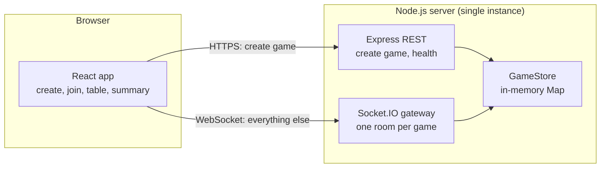
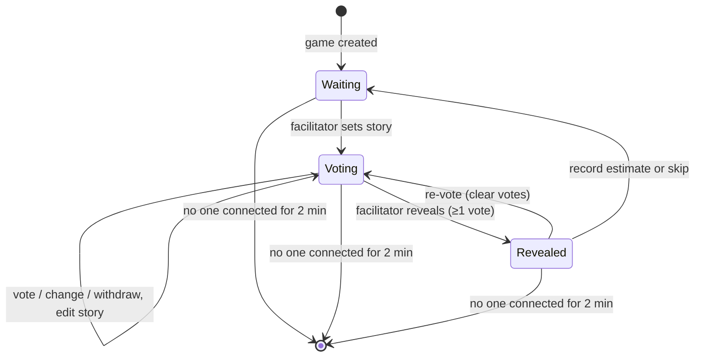
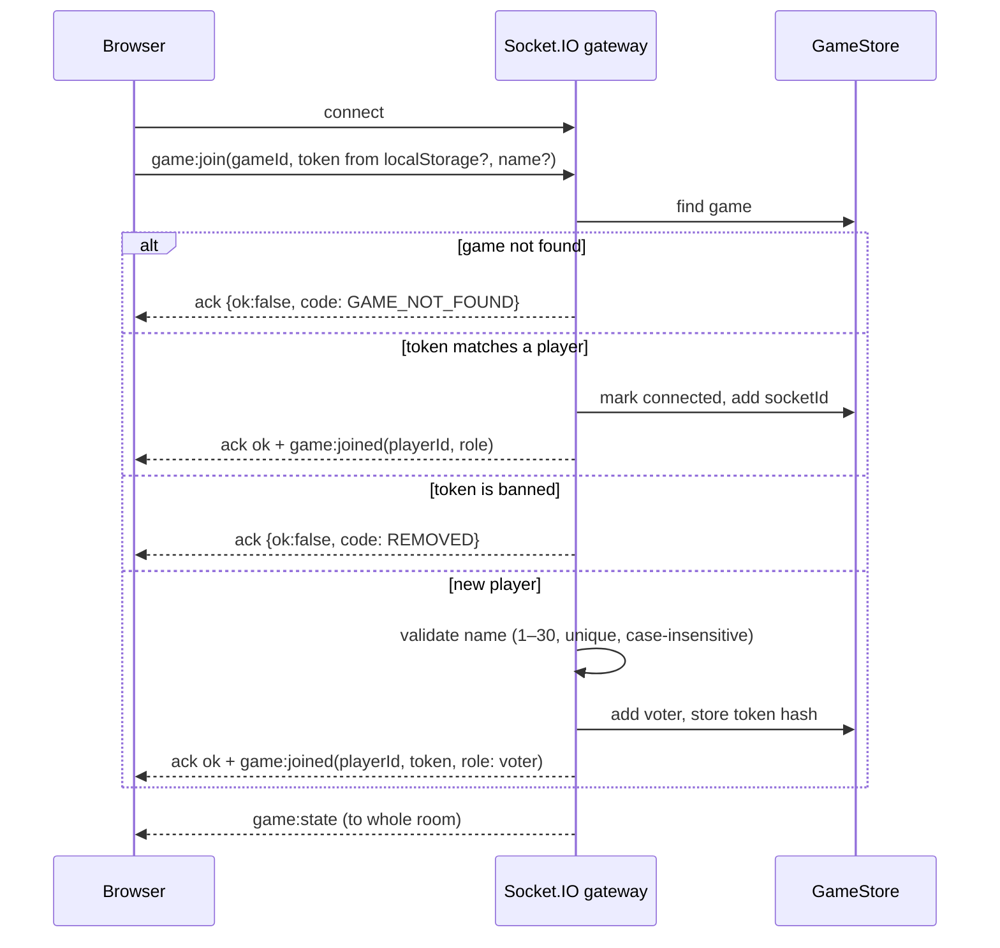
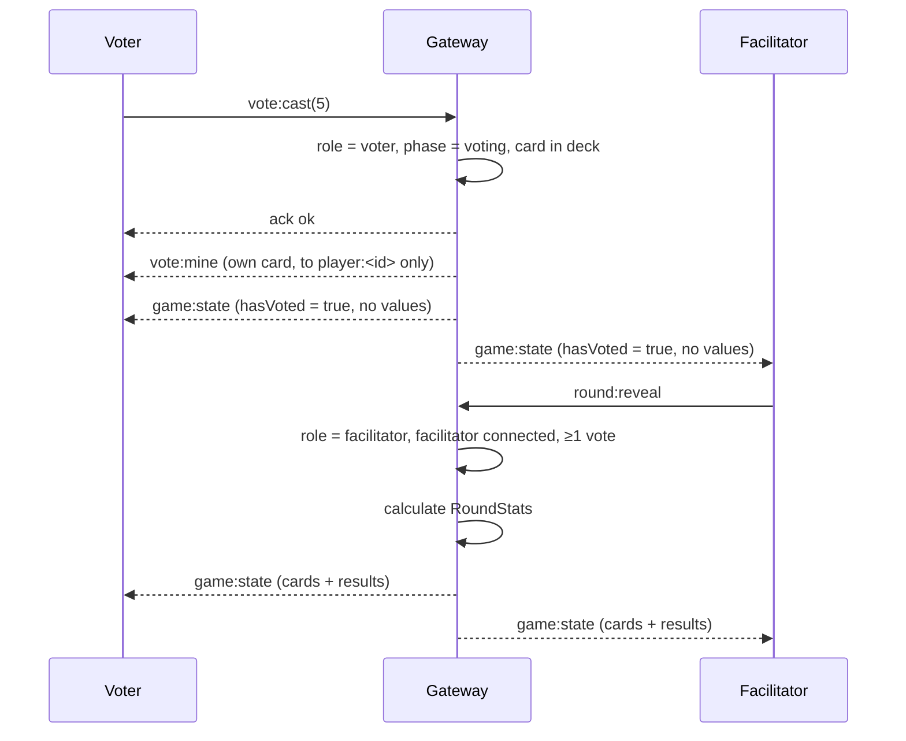

# Design: Planning Poker

## Architecture



- **One process, no database, no Redis.** Requirement 9.1 says games live in memory only, so
  the `GameStore` is a `Map<gameId, Game>` inside the Node process.
- **Single instance.** Games can't be shared across processes without an external store. One
  instance easily handles 100 games × 20 players. If we ever need more, use sticky sessions
  and route by `gameId`, not a shared store.
- **The server owns all state.** Clients send commands; the server checks them and sends
  back a filtered view of the game. Hidden vote values never leave the server, except to the
  voter who owns the vote (Requirement 4.4).
- **Domain logic is pure.** `game.ts` holds the state transitions and `results.ts`
  calculates the results. Neither knows about Socket.IO, so both are easy to unit test.

## Data Model (In Memory)

| Entity | Key fields |
| --- | --- |
| Game | id, facilitatorId, phase (`waiting` / `voting` / `revealed`), story?, players: Map, votes: Map, history: RoundResult[], bannedTokenHashes: Set, lastActiveAt, emptySince? |
| Player | id, name, role (`facilitator` / `voter`), tokenHash, connected, socketIds: Set |
| Story | title, url? |
| Vote | playerId → card |
| RoundResult | story, finalEstimate (number) or `skipped`, recordedAt |

- `Scale` = `'fibonacci' | 'incremental' | 'tshirt'`, chosen when the session is created and
  fixed for its whole life (`Game.scale`). Decks, defined once in `shared/deck.ts`: Fibonacci
  `1, 2, 3, 5, 8, 13, 21`, incremental `1` to `10` (there is no zero card), t-shirt `XS, S, M, L, XL`; every deck also
  has `?` and `coffee`. `Card` is the union of every card of every scale; a scale accepts only
  its own deck. The sized cards (everything but `?` and `coffee`) are the possible estimates.
- `gameId`: 22-character base64url from `crypto.randomBytes(16)` (128 bits, Requirement 1.1).
- Player token: 32 random bytes. Only a SHA-256 hash is stored on the server; the token itself
  lives in the browser's `localStorage`, under a key for each game.
- `socketIds` is a set so a player can have several tabs open. The player counts as connected
  while the set is not empty.

## Game State Machine



- "Next story" is "record estimate or skip" followed by "set story". In `Waiting` the
  facilitator sees the story form; voters see "waiting for the next story".
- The facilitator can skip from `Voting` too (Requirement 6.6); that adds a skipped entry to
  the history and goes back to `Waiting`.

## Realtime Events

All client → server events use Socket.IO acknowledgements: `ack({ ok: true })` or
`ack({ ok: false, code, message })`. Every payload is checked with a Zod schema from
`shared/`.

| Direction | Event | Payload | Who |
| --- | --- | --- | --- |
| C→S | `game:join` | gameId, token?, name? | anyone with the link |
| S→C | `game:joined` | playerId, token (only on first join), role | the joining socket |
| S→C | `game:state` | `PublicGameState` (see below) | everyone in the room |
| C→S | `vote:cast` | `{ card: Card \| null }` (`null` withdraws) | voters, phase `voting` |
| S→C | `vote:mine` | `{ card: Card \| null }` | only the sockets of the voter who owns the vote (room `player:<id>`) |
| C→S | `story:set` | `{ title, url? }` | facilitator, phase `waiting` or `voting` |
| C→S | `round:reveal` | — (any payload ignored) | facilitator, phase `voting`, ≥1 vote |
| C→S | `round:revote` | — (any payload ignored) | facilitator, phase `revealed` |
| C→S | `round:finish` | `{ finalEstimate: 0\|1\|2\|3\|5\|8\|13\|21 }` or `{ skip: true }` | facilitator, phase `revealed` (or `voting` for skip) |
| C→S | `player:remove` | `{ playerId }` | facilitator, any phase |
| S→C | `player:removed` | — | the removed player, then disconnect |
| C→S | `facilitator:transfer` | `{ playerId }` | facilitator, any phase; target must be an online voter other than the sender |
| S→C | `game:ended` | `{ reason: 'server-restart' \| 'expired' }` | everyone in the game (server shutdown, or the game hit its age cap) |

- Every socket that joins also joins the room `player:<playerId>`. `vote:mine` is emitted to
  that room only, so all tabs of one voter are updated and nobody else receives the card.
- `story:set` success: ack, then `game:state` to the game room. `vote:cast` success: ack,
  then `vote:mine` to `player:<id>`, then `game:state` to the game room. Re-casting the same
  card and withdrawing without a vote are idempotent successes. On failure only the ack is
  sent.
- `game:join` by a voter also emits `vote:mine` (the current card or `null`) to the joining
  socket, after `game:joined` and before the room `game:state`. The facilitator never
  receives `vote:mine`.
- `round:revote` and `round:finish` success: ack, then `vote:mine { card: null }` to every
  voter's `player:<id>` room (their decks clear in all tabs), then `game:state` to the game room.
  A re-vote goes back to `voting` on the same story; a finish appends `{ title, url?, estimate }`
  to `history` (estimate is the number or `'skipped'`), clears all votes and the story, and
  moves to `waiting`.
- `player:remove` success: ack, then `player:removed` to the removed voter's `player:<id>` room,
  the server disconnects every socket of that voter, then `game:state` to the game room. The
  voter's vote is discarded, the voter is deleted (their name is free again) and the SHA-256 of
  their token is added to `bannedTokenHashes`. Results are recalculated when the round is
  revealed.
- `facilitator:transfer` is the only way the role moves. Check order: not joined (`FORBIDDEN`),
  game gone, payload is an object (`INVALID_PAYLOAD`), sender is the facilitator
  (`FORBIDDEN`), then the target: it must be a string naming a player who is a voter, is not the
  sender and is online (`INVALID_PAYLOAD` otherwise, also for a removed or unknown id). On
  success the domain swaps the two roles, sets `facilitatorId` and deletes the new
  facilitator's vote; then: ack, `game:joined { playerId, role }` (no token: the seat does not
  change) and `vote:mine { card: null }` to the `player:<id>` rooms of both players, then
  `game:state` to the game room. Because the role lives on the player and tokens find players,
  a rejoin with either token gets the current role; banned tokens stay banned. Results are
  recalculated from the remaining votes when the round is revealed.
- A missing ack callback is tolerated: the event is still processed.

### `PublicGameState`

The server builds this for each game every time the state changes, and sends the same
object to everyone in the room. Vote values are left out unless the phase is `revealed`;
`game:state` never carries a vote value before then. `hasVoted` is the only vote
information in it. The own card of a voter travels separately in `vote:mine`.

```typescript
type PublicGameState = {
  gameId: string;
  scale: 'fibonacci' | 'incremental' | 'tshirt';
  phase: 'waiting' | 'voting' | 'revealed';
  story: { title: string; url?: string } | null;
  facilitator: { name: string; connected: boolean };
  voters: Array<{ id: string; name: string; connected: boolean; hasVoted: boolean; card?: Card }>;
  results?: RoundStats; // only when revealed
  history: Array<{ title: string; url?: string; estimate: Card | 'skipped' }>; // sized cards only
  total: number | null; // null for t-shirt sizes, which cannot be added up
};

type RoundStats = {
  distribution: Array<{ card: Card; count: number }>;
  average: number | null; // numeric scales only; null for t-shirt or with no sized votes
  median: Card | null;    // the middle sized vote (the higher middle on an even count)
  consensus: boolean;
  outlierIds: string[];   // empty when consensus or fewer than 2 distinct sized values
  suggestedEstimate: Card | null; // a sized card of the scale
};
```

Because the facilitator does not vote, everyone can be sent the same object; each client
compares its own `playerId` to highlight its card.

## Key Flows

### Join and Reconnect



- Creating a game is the only REST call: `POST /api/games { name }` returns
  `{ gameId, token }`. The client saves the token, then sends `game:join` like everyone else.
- The facilitator reconnects the same way; their token maps to their current role (after a
  handover that is `voter` for the old facilitator and `facilitator` for the new one)
  (Requirement 8.3). The role never moves to another player (Requirement 8.4).

### Vote and Reveal



## Results Calculation

`results.ts` is a pure function
`calculateStats(votes: Map<string, Card>, scale: Scale): RoundStats`.

- **Sized votes:** votes on the sized cards of the scale (numbers, or sizes for t-shirt). `?`
  and coffee are counted in `distribution` only. Cards are ordered by their place in the deck:
  value order for numbers, `XS < S < M < L < XL` for sizes.
- **Average (numeric scales):** mean of the sized votes rounded half up to one decimal
  (computed with integers: `floor((20 * sum + n) / (2 * n)) / 10`); `null` if there are none,
  and always `null` for t-shirt.
- **Median:** the middle sized vote in deck order; with an even count the higher of the two
  middle cards; `null` if there are none. Shown for t-shirt (instead of an average).
- **Consensus:** at least two sized votes and all of them equal.
- **Outliers:** if there are at least two distinct sized values, every voter whose vote equals
  the lowest or the highest.
- **Suggested estimate:** the consensus card; otherwise, for the numeric scales, the sized card
  closest to the average (when two are equally close, take the higher one), and for t-shirt the
  median; `null` if there are no sized votes.

| Scale | Votes | Average | Median | Consensus | Outliers | Suggested |
| --- | --- | --- | --- | --- | --- | --- |
| fibonacci | 5, 5, 5 | 5.0 | 5 | yes | — | 5 |
| fibonacci | 3, 5, 8 | 5.3 | 5 | no | 3, 8 | 5 |
| fibonacci | 5, ?, coffee | 5.0 | 5 | no (one sized vote) | — | 5 |
| fibonacci | ?, coffee | — | — | no | — | — |
| fibonacci | 2, 3 | 2.5 | 3 | no | 2, 3 | 3 |
| incremental | 4, 6 | 5 | 6 | no | 4, 6 | 5 |
| incremental | 0, 10 | 5 | 10 | no | 0, 10 | 5 |
| tshirt | M, M, M | — | M | yes | — | M |
| tshirt | S, M, XL | — | M | no | S, XL | M |
| tshirt | S, L | — | L | no | S, L | L |
| tshirt | XS, S, M, L | — | M | no | XS, L | M |

## Game Lifetime

- A game records `createdAt`, and `emptySince` while no player (facilitator included) has a
  socket. `emptySince` is set when the game is created, when the last socket of the last
  connected player disconnects, and by the sweep as a safety net; it is cleared on every
  successful `game:join`. This makes the 2-minute rule exact instead of late by up to one sweep.
- A sweep runs every 30 seconds (`SWEEP_INTERVAL_MS`) on a timer that is `unref`ed. It deletes
  games that have been empty for 2 minutes (`GAME_EMPTY_TTL_MS`, Requirement 9.2) and games
  older than 2 hours (`GAME_MAX_AGE_MS`) whatever their state, so memory can't grow without
  limit. The three durations are validated at startup (positive integers of milliseconds).
- A game deleted for its age may still have players: they receive `game:ended { reason:
  'expired' }` and are disconnected. An empty game has nobody to tell. A deleted game's link
  shows "Game not found".
- On `SIGTERM` (and `SIGINT`) the server stops the sweeper, sends `game:ended { reason:
  'server-restart' }` to every connected socket, disconnects them (the event is queued before
  the disconnect), closes the servers and exits `0`; a second signal, or 5 seconds, exits at
  once.
- Players are told in a footer on every page that games are temporary and end when the server
  restarts (Requirement 9.3).
- Logs for deletion and shutdown carry `gameId`, `reason` and counts only.

## REST API

- `POST /api/games` → `201 { gameId, token }`. Rate-limited per IP.
- `GET /api/games/:id/exists` → `200 { exists }`, used to show "game not found" before the
  name prompt. Rate-limited per IP so it can't be used to enumerate games.
- `GET /healthz` → `200`.

## Front End

- **Routes (React Router):** `/` (create game), `/g/:gameId` (join prompt, then the table),
  plus a not-found view.
- **State:** a small Zustand store holds the latest `PublicGameState`, `playerId` and the
  connection status. All updates come from `game:state`; the client never changes the game on
  its own (no optimistic updates), so the UI can't get out of sync.
- **Components:** `CardDeck`, `PokerTable` (voters with voted/offline badges),
  `StoryPanel` (story form for the facilitator, read-only for voters), `ResultsPanel`
  (distribution bars, average, consensus/outlier badges), `FacilitatorControls`,
  `SessionSummary` (with copy as text), `ThemeToggle`.
- **Styling:** Tailwind CSS with `dark:` variants (class strategy: `@custom-variant dark` in
  `index.css`). The theme is light or dark; `<html class="dark">` and `color-scheme` follow it.
  With no saved choice the page follows `prefers-color-scheme`, also while the OS setting
  changes; the `ThemeToggle` (a "Dark mode" toggle button with `aria-pressed`, in the page
  header) saves the choice in `localStorage` under `axon.theme` (`light` or `dark`; any other
  value is ignored, and a storage error only means the choice is not remembered). A blocking
  external script, `theme-init.js` in `<head>`, applies the theme before the first paint; it is
  a file because the CSP allows `script-src 'self'` only. Every colour has a dark counterpart,
  and `lib/palette.ts` lists them so a unit test can check WCAG AA contrast for both themes and
  fail for a colour class that is not listed.
- **Name, logo and wording:** the product is "Planning Poker" with the subtitle "Story
  refinement". The create page shows the name as its heading; every other page shows it as plain
  text at the left of the header, and every page shows the original SVG logo (also the favicon)
  at the top right as the only link home, with the theme toggle to its left. The UI never says
  "game": the word is "session" (identifiers, URLs, events and storage keys keep their names).
  The estimation page heading is "Story Estimation".
- **Type scale:** one scale in `index.css` (`type-display`, `type-title`, `type-brand`,
  `type-section`, `type-body`, `type-name`, `type-meta`); section headings are clearly larger
  than the names below them and status text is smaller and muted. Nothing is under 14 px.
- **Layout:** one column below 1024 px (centred, up to 48 rem from 640 px); from 1024 px the
  estimation page is two columns inside 72 rem: the work area (story, deck, controls, results)
  on the left and the people area (facilitator and voters, summary, join link) on the right.
  The DOM order is the visual order, so tab order never differs from what is seen. On phones the
  deck is a grid of 5 columns (10 from 768 px), primary buttons are full width, and every
  control is at least 44 px with at least 8 px between neighbours.
- **Size colours:** every sized card has a level from 0 (smallest) to 4 (largest), the same five
  steps for every scale (`shared/size.ts`): Fibonacci 1-2, 3, 5, 8, 13-21; incremental 1-2,
  3-4, 5-6, 7-8, 9-10; t-shirt XS, S, M, L, XL. Levels map to a green, lime, amber, orange and
  red ramp (`lib/sizeStyles.ts`, with dark variants), used on deck cards (a tint, solid when
  selected), revealed voter cards, distribution bars and summary estimates; `?` and coffee stay
  neutral. Colour is never the only cue: every coloured card carries a five-segment size bar
  (`level + 1` filled) and keeps its text value.
- **Too large:** from Fibonacci 13, incremental 8 and t-shirt L a card is too large to take on as
  one story (`isTooLarge`). It shows a ⚠ mark and is described, not renamed (the accessible name
  stays the value), the deck has a visible legend, results and the summary say "Too large", the
  facilitator sees "Too large: consider splitting this story." next to the Final estimate while
  the select shows such a card, and the reveal announcement adds ", too large to take as one
  story" when the proposal is too large.
- **Handover:** the facilitator sees "Make facilitator" next to "Remove" on every online voter
  (`MakeFacilitatorButton`, two clicks like Remove; focus returns to the button on cancel). The
  client never changes role on its own: it follows the server's `game:joined { role }`, so the
  page swaps between the voter view (deck) and the facilitator view (story, reveal, estimate,
  remove) when that arrives. The live region says "<name> is now the facilitator" for every
  player; the matching removal of that voter from the list is not announced as a removal.
- **Panels:** every section is its own panel (`Panel`: shaded background, thin border, rounded
  corners, 16 to 20 px padding, 24 px between panels, a very light shadow in light mode only,
  never `overflow-hidden` so focus rings are not cut off). Work area: Story, Your vote, Round
  controls (one region around Reveal and the facilitator controls), Results. People area:
  Facilitator, Voters, Summary, Join link. The create form, the join prompt and the not-found,
  ended and removed views are one panel each; the header, page heading, banners and footer stay
  outside. The border is decorative (the heading carries the meaning); text and control colours
  inside panels are checked against the panel background (slate-50 / slate-800) in
  `lib/palette.ts`.
- **Story links:** when a story has a link the title itself is the link (new tab, `noopener
  noreferrer`); the address is not shown.
- **Accessibility:** cards are a radio group (arrow keys and Space); an `aria-live` region
  announces "Anna voted", the reveal and the consensus result.
- **Links:** story URLs are rendered as `<a target="_blank" rel="noopener noreferrer">` only
  after they pass the `http`/`https` check on both client and server.

## Project Layout

```text
src/axon/                        # Express + Socket.IO server
  src/
    domain/game.ts               # state transitions, guards
    domain/results.ts            # calculateStats
    store/gameStore.ts           # Map + sweeper
    realtime/gateway.ts          # Socket.IO handlers → domain
    http/routes.ts               # POST /api/games, exists, healthz
src/axon.Shared/                 # Zod schemas, Card, event types (used by server and client)
src/axon.Frontend/               # React app
src/axon.E2ETests/               # Playwright tests
```

Paths follow the source paths in [project-config.md](../../../project-config.md).

## Security

- **Authorization:** each facilitator event checks that the sender's player has
  `role === 'facilitator'` in that game; each voter event checks `role === 'voter'`. The
  check is in the domain layer, not only in the UI.
- **Vote privacy:** before the reveal no client other than the voter who owns the vote
  receives a vote value. `game:state` carries only `hasVoted`; the card goes to the owner's
  `player:<id>` room as `vote:mine`. The facilitator does not vote and never receives it.
- **Tokens:** generated on the server, stored as hashes, compared in constant time, sent only
  in the `game:join` payload (never in URLs or logs).
- **Input:** Zod validation on every event; names and titles are trimmed and length-checked;
  React escapes all text by default and `dangerouslySetInnerHTML` is not used.
- **Rate limiting:** `express-rate-limit` on REST; on WebSocket, a token bucket for each
  socket (for example 10 events per second) and a limit on connections per IP.
- **Transport:** HTTPS/WSS only; Socket.IO `cors.origin` limited to the app's origin;
  `helmet` sets security headers including a strict CSP.
- **Logging:** structured logs with `gameId` and event names only; no names, story text or
  tokens.

## Error Handling

- Error codes: `GAME_NOT_FOUND`, `NAME_TAKEN`, `INVALID_NAME`, `INVALID_STORY`,
  `INVALID_CARD`, `WRONG_PHASE`, `FORBIDDEN`, `REMOVED`, `RATE_LIMITED`.
- Added by story #2 (all share one enum in `@axon/shared`):
  - Socket (`game:join` ack): `INVALID_TOKEN` (the token does not match a player of that
    game), `INVALID_PAYLOAD` (the payload is not an object or `gameId` is not a string) and
    `ALREADY_JOINED` (the socket has already joined a game).
  - REST (`{code, message}` body): `INVALID_REQUEST` (400, the body is not a JSON object)
    and `PAYLOAD_TOO_LARGE` (413, the body is over 1 kB).
  - Check order on `game:join`: payload shape, `ALREADY_JOINED`, `gameId` format and
    existence (`GAME_NOT_FOUND`), then the token (`INVALID_TOKEN`) or the name
    (`INVALID_NAME`, `NAME_TAKEN`). An unknown game wins over a bad name.
- Added by story #3 (`story:set` and `vote:cast` acks, fixed messages in `ERROR_MESSAGES`):
  - `INVALID_STORY` (title not 1–200 code points, control characters, or a link that is not an
    absolute `http`/`https` URL up to 2048 characters), `INVALID_CARD` (the card is not in the
    deck and not `null`), `FORBIDDEN` (the socket has not joined a game, or the role is wrong:
    a voter sets a story or the facilitator votes) and `WRONG_PHASE` (`vote:cast` while
    `waiting`).
  - Check order for both events, first failure wins: not joined (`FORBIDDEN`), game missing
    (`GAME_NOT_FOUND`), payload envelope (`INVALID_PAYLOAD`; for `vote:cast` also a missing
    `card` key), role (`FORBIDDEN`), phase (`WRONG_PHASE`), value (`INVALID_STORY` /
    `INVALID_CARD`). Authorization comes before value validation, so a voter never learns the
    story rules.
- Added by story #4 (`round:reveal` acks; no new codes):
  - `round:reveal` check order: not joined (`FORBIDDEN`), game missing (`GAME_NOT_FOUND`), role
    (`FORBIDDEN`), phase `voting` and at least one vote (`WRONG_PHASE`). A second reveal is
    `WRONG_PHASE`.
  - In phase `revealed`, `vote:cast` and `story:set` return `WRONG_PHASE` (role checks still come
    first, so a voter setting the story or the facilitator voting is `FORBIDDEN`).
  - `story:set` is allowed in phase `waiting` or `voting` only.
- Added by story #5 (`round:revote` and `round:finish` acks; no new codes):
  - `round:revote` check order: not joined (`FORBIDDEN`), game missing (`GAME_NOT_FOUND`), role
    (`FORBIDDEN`), phase `revealed` (`WRONG_PHASE`).
  - `round:finish` check order: not joined, game missing, payload envelope (`INVALID_PAYLOAD`:
    not an object, or not exactly one of `finalEstimate` / `skip: true`), role (`FORBIDDEN`),
    phase (`WRONG_PHASE`: an estimate needs `revealed`, a skip needs `voting` or `revealed`),
    value (`INVALID_CARD`: the estimate is not a numeric deck value; `?` and coffee are rejected).
- Changed by story #28: the link is required and the title is optional. `INVALID_STORY` now
  means a missing, blank or non-URL link (it must be an absolute `http`/`https` URL up to 2048
  characters), or a title over 200 characters or with a control character. A blank title is
  stored as `''` and the link is then shown as the story.
- Added by story #22: `INVALID_SCALE` (`POST /api/games` with a `scale` that is not one of the
  three exact strings; the name is checked first, a missing scale means Fibonacci). `vote:cast`
  and `round:finish` check the card against the session's own scale and answer `INVALID_CARD`
  for a card of another scale; `round:finish` also rejects `?` and coffee.
- Added by story #6:
  - `REMOVED` (fixed message "You were removed from this game."): `game:join` with the token of a
    removed voter. On `game:join` the banned check comes before the token lookup, so the order
    is: payload shape, `ALREADY_JOINED`, `gameId`, then token (`REMOVED`, else `INVALID_TOKEN`)
    or name.
  - `player:remove` check order: not joined (`FORBIDDEN`), game missing (`GAME_NOT_FOUND`),
    payload is an object (`INVALID_PAYLOAD`), role (`FORBIDDEN`), then the target: it must be
    the id of a current voter (`INVALID_PAYLOAD` for a missing or non-string id, an unknown or
    already removed id, or the facilitator).
- The client shows a friendly message for each code; unknown errors show a generic message.
- Socket.IO reconnects automatically; on reconnect the client sends `game:join` again with
  its token and gets the full `game:state`, so missed updates don't matter.
- No stack traces or internal IDs in error messages outside development.

## Testing Strategy

- **Unit (Vitest):** `calculateStats` (the table above plus edge cases), state transitions
  and guards in `game.ts` (wrong phase, wrong role, removed player), Zod schemas, sweeper
  timing with fake timers.
- **Integration (Vitest + `socket.io-client`):** start the server on a random port; check the
  event contract, that vote values are never sent before reveal, the facilitator-only
  checks, reconnect with a token, and ban after removal.
- **Front end (Vitest + Testing Library):** `CardDeck` keyboard use, `ResultsPanel`
  rendering for consensus/outlier/no-average, theme toggle.
- **E2E (Playwright):** one facilitator and three voter browser contexts play a full round,
  re-vote, record an estimate, check the summary; facilitator reload restores the role.
- **Accessibility:** `@axe-core/playwright` on the join, voting and revealed views in both
  themes.

## Technology Stack

Follows [project-config.md](../../../project-config.md): Node.js 20 + TypeScript + Express on
the back end, React 19 + TypeScript + Vite on the front end, Playwright for E2E.

| Concern | Choice | Why |
| --- | --- | --- |
| Realtime | Socket.IO | Rooms, acknowledgements and automatic reconnect built in. |
| Validation | Zod (shared) | One schema for client and server, so the event contract can't drift. |
| Client state | Zustand | One store fed by `game:state`; no REST data, so TanStack Query isn't needed. |
| Styling | Tailwind CSS + shadcn/ui | Dark mode via `dark:`; accessible dialogs and buttons. |
| Security | helmet, express-rate-limit | Standard Express hardening. |
| Storage | None (in-memory `Map`) | Requirement 9.1. |

Compared with the Menti clone, this design has no PostgreSQL, Redis, object storage, auth or
REST CRUD.
